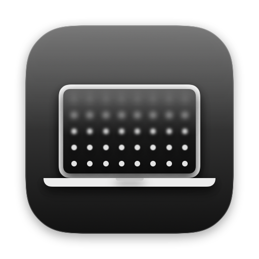

<p align="center">
  
</p>

<h1 align="center">Haze</h1>

<p align="center">
  <b>The iPhone Duo's fold blur, on a MacBook.</b><br>
  Close the lid and the screen frosts over · open it and the haze clears.
</p>

<p align="center">
  
  
  
  
  <a href="https://github.com/zaineldinbarakat-droid/haze/releases/latest"></a>
  <a href="LICENSE"></a>
</p>

<p align="center">
  <a href="https://github.com/zaineldinbarakat-droid/haze/releases/latest/download/Haze.zip"><b>⬇︎ Download Haze</b></a>
  &nbsp;·&nbsp;
  <a href="#install">Install</a>
  &nbsp;·&nbsp;
  <a href="#under-the-hood">Under the hood</a>
</p>

Close the lid and the screen frosts over and dims from the top edge down, the way the
Duo's inner screen does as it folds; open it and the haze clears again.

- **Follows the lid.** Haze reads the MacBook's lid angle sensor, and the haze depends
  on the angle alone: none above the start angle (91° by default), full at the
  full-haze angle (31°), in proportion in between. Opening only ever clears it. Hold
  the lid still and the screen clears after two seconds.
- **Sharp at the hinge.** The top edge goes soft first; the hinge stays sharp longest.
- **Wakes up hazy.** The screen goes to sleep hazed and clears as you open the lid.
  Macs without a lid sensor get just this part: the haze clears on every wake.
- **Stays out of the way.** It's a click-through overlay on the built-in display only,
  and it's ordered out whenever the lid isn't moving.

**Settings** (from the menu bar icon, or open Haze again while it's running):

- **Starts at** and **Full haze at**: the lid angles the haze begins and peaks at.
  Tilt the lid to an angle and click **Set** to use it. **Lid now** shows the live
  angle and how hazy that is.
- **Clears after**: how long the lid has to stay still before the screen clears.
- **Blur** and **Dimming**: how frosted and how dark the screen gets.
- **Preview**: plays a close and open without touching the lid.
- **Open at login**.

## Install

1. [Download **Haze.zip**](https://github.com/zaineldinbarakat-droid/haze/releases/latest/download/Haze.zip), unzip it and drag **Haze** into **Applications**.
2. Haze isn't notarized by Apple yet, so the first launch is blocked: open **System Settings → Privacy & Security** and click **Open Anyway** — or run once in Terminal:
   ```bash
   xattr -dr com.apple.quarantine /Applications/Haze.app
   ```
3. Click the laptop icon in the menu bar → **Settings…** to pick where the haze starts.

**Requires** a Mac with Apple Silicon and macOS 14 Sonoma or later. The lid-following effect needs a MacBook with a lid angle sensor, which newer models have; Haze's menu shows whether yours does. Without one, Haze clears the haze on wake only.

## Build

Requires Xcode and macOS 14 or later on Apple silicon.

```bash
git clone https://github.com/zaineldinbarakat-droid/haze.git && cd haze
./build.sh            # builds build/Haze.app
./install.sh          # builds, installs to /Applications and opens it
./release.sh 0.1.1    # bumps VERSION and packs build/Haze.zip for a GitHub release
```

To look at the effect frozen at one strength (0 to 1), optionally with other settings:

```bash
open build/Haze.app --args -HazeHold 0.6 -blur 0.5 -dimming 0.3
```

## Under the hood

- `LidSensor.swift` reads the hinge angle from the Apple HID device on the sensor
  usage page (`0x20`, usage `0x8A`). It's undocumented, so Macs without it fall back
  to sleep and wake.
- `HazeEngine.swift` turns the angle into a haze strength, from the start angle down
  to the full-haze angle, and eases toward it at 60 fps while the lid moves. It polls at 15 Hz
  otherwise.
- `HazeSettings.swift` and `SettingsView.swift` are the settings and their window.
- `Packaging/make-icons.swift` draws the icon: `swift Packaging/make-icons.swift`
  rewrites `Haze.icns` and `Haze-icon.png`.
- `HazeOverlay.swift` draws it: a behind-window `NSVisualEffectView` masked by a
  gradient that creeps from the top edge toward the hinge, plus a black gradient that
  dims the screen.
